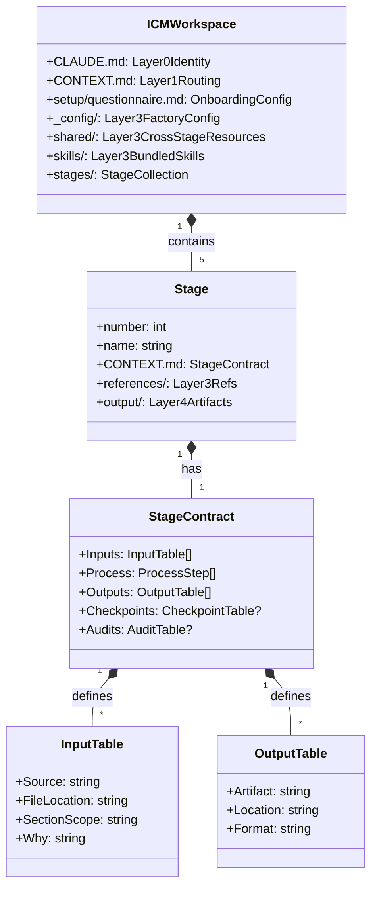

# REASONS Canvas: ICM Workspace Implementation for Bhavya OS

## R — Requirements

### Business Context

Bhavya OS needs a portable, agent-agnostic workflow architecture that enables:

- **Multi-agent handoffs**: Multiple AI agents (opencode, Claude Code, Cursor, etc.) can work on the same project with explicit handoffs
- **Machine portability**: Workspace works identically across different machines without reconfiguration
- **Human-in-the-loop**: Creative decisions have explicit checkpoints for human steering
- **Observability**: Every workflow state is visible as plain files on disk
- **Token efficiency**: Layered context loading keeps model context in optimal 2K-8K range

The current hub-based navigation (AGENTS.md → CONTEXT.md → hubs) solves routing but not workflow orchestration. ICM provides the missing workflow layer.

### Scope

**IN:**

- ICM workspace structure at repo root (CLAUDE.md, CONTEXT.md, stages/, _config/, shared/, setup/, skills/)
- Core 5-stage development workflow (01-discovery → 02-specification → 03-implementation → 04-verification → 05-deployment)
- Stage contracts with Inputs/Process/Outputs tables per ICM Pattern 1
- Stage handoffs via output/ folders per ICM Pattern 2
- Onboarding questionnaire in setup/questionnaire.md per ICM Pattern 8
- Bundled skills from .opencode/skills/ per ICM Pattern 9
- Checkpoints and audits for creative stages per ICM Patterns 11-12
- Coexistence with existing AGENTS.md and hub navigation

**OUT:**

- Replacing AGENTS.md (opencode config remains)
- Migrating all existing workflows in Phase 1 (only core dev workflow)
- Building ICM runtime/tooling (relies on agent discipline)
- Changing package/app architecture (separate concern)

### Success Criteria

- [ ] ICM workspace structure created at repo root with all 5 layers
- [ ] 5 core development stages created with valid CONTEXT.md contracts
- [ ] Stage handoffs work: output of stage N readable as input to stage N+1
- [ ] Onboarding questionnaire runs and populates _config/ and shared/
- [ ] Existing AGENTS.md and CONTEXT.md still functional for opencode
- [ ] Walk test passes: agent with no memory can orient, act, report from files alone
- [ ] All 15 ICM conventions documented and followed

### Constraints

| Type       | Constraint                                 | Source                                        |
| ---------- | ------------------------------------------ | --------------------------------------------- |
| Technical  | Must not break existing opencode sessions  | AGENTS.md rule 2                              |
| Technical  | Must follow ICM 15 conventions exactly     | RFC-0014, ICM _core/CONVENTIONS.md            |
| Governance | Architecture changes require RFC + Canvas  | AGENTS.md §Architecture-change trigger        |
| Design     | Must use Bhavya tokens (forest/ivory/gold) | 01-BRAND-CONSTITUTION.md, 05-DESIGN-SYSTEM.md |
| Technical  | No new dependencies unless justified       | AGENTS.md rule 10                             |
| Business   | Must enable multi-agent handoffs           | RFC-0014 motivation                           |

---

## E — Entities



### Entity Definitions

| Entity          | Purpose                            | Key Fields                                                                                | Relationships               |
| --------------- | ---------------------------------- | ----------------------------------------------------------------------------------------- | --------------------------- |
| ICMWorkspace    | Root workspace container           | CLAUDE.md, CONTEXT.md, stages/, _config/, shared/, setup/, skills/                        | Contains 5 stages           |
| Stage           | Single workflow step               | number, name, CONTEXT.md, references/, output/                                            | Sequential (01→02→03→04→05) |
| StageContract   | Machine-readable stage definition  | Inputs[], Process[], Outputs[], Checkpoints?, Audits?                                     | One per stage               |
| InputTable      | Scoped context loading instruction | Source, FileLocation, SectionScope, Why                                                   | Defines what agent loads    |
| OutputTable     | Artifact specification             | Artifact, Location, Format                                                                | Defines what agent produces |
| Layer3Reference | Stable factory config              | brand-rules.md, design-tokens.md, build-conventions.md, skills/                           | Referenced by InputTables   |
| Layer4Artifact  | Per-run working artifact           | discovery-report.md, spec.md, code-changes/, verification-report.md, deployment-record.md | Handoff from stage N to N+1 |

---

## A — Approach

### Strategy

Implement ICM workspace as a **parallel workflow layer** that coexists with existing hub navigation. The ICM stages encode the _existing_ Bhavya development workflow (RFC → Spec → Implement → Verify → Deploy) as explicit, reviewable stages. This is not a new workflow — it's making the implicit workflow explicit and portable.

Key strategic decisions:

1. **Coexistence over replacement**: AGENTS.md stays for opencode; CLAUDE.md added for portability
2. **Symlink skills**: `.opencode/skills/` → `skills/` avoids duplication
3. **Reference existing hubs**: `.ai/`, `docs/`, `packages/` become Layer 3 collections
4. **Minimal Phase 1**: Only core 5-stage dev workflow; other workflows in Phase 3

### Trade-offs

| Decision             | Chosen                              | Rejected                 | Reason                                              |
| -------------------- | ----------------------------------- | ------------------------ | --------------------------------------------------- |
| L0 file              | CLAUDE.md + AGENTS.md coexist       | Replace AGENTS.md        | opencode needs AGENTS.md; CLAUDE.md for portability |
| Skills location      | Symlink .opencode/skills/ → skills/ | Copy skills              | Avoids drift; single source of truth                |
| Hub integration      | Hubs become Layer 3 refs            | Replace hubs with stages | Hubs serve navigation; stages serve workflows       |
| Stage granularity    | 5 stages for core dev workflow      | More/fewer stages        | Matches existing RFC→Spec→Impl→Verify→Deploy        |
| Checkpoint placement | Stages 02, 03, 04 (creative)        | All stages               | Linear stages (01, 05) don't need checkpoints       |

### Architecture Impact

- **Packages affected**: None (workspace structure only)
- **Routes affected**: None
- **Contracts affected**: None
- **Database changes**: No
- **File layout**: New directories at repo root (CLAUDE.md, CONTEXT.md, stages/, _config/, shared/, setup/, skills/)

---

## S — Structure

### File Layout

```
D:\Bhavya OS\
├── CLAUDE.md                           # L0: Workspace identity & routing
├── CONTEXT.md                          # L1: Task → stage routing (updated)
├── setup/
│   └── questionnaire.md                # L3: Factory configuration
├── _config/                            # L3: Factory config (stable across runs)
│   ├── brand-rules.md                  # Brand voice, palette, typography
│   ├── design-tokens.md                # CSS token references
│   └── build-conventions.md            # Build commands, verification gates
├── shared/                             # L3: Cross-stage resources
│   ├── constants/
│   │   ├── design-tokens.ts            # Shared design constants
│   │   └── api-constants.ts            # Shared API constants
│   └── schemas/
│       ├── stage-contract.schema.json  # JSON schema for stage contracts
│       └── handoff.schema.json         # JSON schema for handoff artifacts
├── skills/                             # L3: Bundled skills (symlink)
│   └── .opencode/skills/ → ../../.opencode/skills/
├── stages/                             # L2: Numbered workflow stages
│   ├── 01-discovery/
│   │   ├── CONTEXT.md                  # Stage contract
│   │   ├── references/                 # Stage-specific refs
│   │   │   ├── rfc-process.md
│   │   │   └── codebase-map.md
│   │   └── output/                     # Handoff artifacts
│   │       └── .gitkeep
│   ├── 02-specification/
│   │   ├── CONTEXT.md
│   │   ├── references/
│   │   │   ├── reasons-canvas-guide.md
│   │   │   └── spec-standards.md
│   │   └── output/
│   │       └── .gitkeep
│   ├── 03-implementation/
│   │   ├── CONTEXT.md
│   │   ├── references/
│   │   │   ├── coding-standards.md
│   │   │   ├── git-workflow.md
│   │   │   └── package-conventions.md
│   │   └── output/
│   │       └── .gitkeep
│   ├── 04-verification/
│   │   ├── CONTEXT.md
│   │   ├── references/
│   │   │   ├── verification-gates.md
│   │   │   └── anti-slop-rules.md
│   │   └── output/
│   │       └── .gitkeep
│   └── 05-deployment/
│       ├── CONTEXT.md
│       ├── references/
│       │   ├── deploy-checklist.md
│       │   └── rollback-procedure.md
│       └── output/
│           └── .gitkeep
```

### Dependencies

| Component              | Depends On          | Type               |
| ---------------------- | ------------------- | ------------------ |
| CONTEXT.md (L1)        | CLAUDE.md (L0)      | import             |
| Stage CONTEXT.md       | CONTEXT.md (L1)     | import             |
| Stage CONTEXT.md       | _config/* (L3)      | import (selective) |
| Stage CONTEXT.md       | shared/* (L3)       | import (selective) |
| Stage CONTEXT.md       | skills/* (L3)       | import (selective) |
| Stage N+1 output       | Stage N output      | data (handoff)     |
| setup/questionnaire.md | _config/_, shared/_ | writes             |

### Interfaces

```typescript
// StageContract — ICM Pattern 1
interface StageContract {
  inputs: InputEntry[];
  process: ProcessStep[];
  outputs: OutputEntry[];
  checkpoints?: CheckpointEntry[];
  audits?: AuditEntry[];
}

interface InputEntry {
  source: string; // e.g., "Previous stage", "Style guide", "Skill"
  fileLocation: string; // e.g., "../01-discovery/output/", "../../_config/brand-rules.md"
  sectionScope: string; // e.g., "Full file", "Voice Rules section", "Index then load rules"
  why: string; // e.g., "Source material", "Tone guidance"
}

interface OutputEntry {
  artifact: string; // e.g., "Discovery report"
  location: string; // e.g., "output/discovery-report.md"
  format: string; // e.g., "Markdown with metadata header"
}

interface CheckpointEntry {
  afterStep: number;
  agentPresents: string; // e.g., "Three spec options with trade-offs"
  humanDecides: string; // e.g., "Which approach to pursue"
}

interface AuditEntry {
  check: string; // e.g., "All types reference @bhavya/shared"
  passCondition: string; // e.g., "No local type definitions for shared entities"
}

// Handoff artifact — ICM Pattern 2
interface HandoffArtifact {
  stage: number;
  artifactType: string;
  topicSlug: string;
  content: string;
  metadata: {
    createdAt: string;
    createdBy: string;
    stageContractVersion: string;
  };
}
```

---

## O — Operations

### Step 1: Create ICM Workspace Root Files

1. **Responsibility:** Create CLAUDE.md (L0) and update CONTEXT.md (L1)
2. **Location:** `D:\Bhavya OS\CLAUDE.md`, `D:\Bhavya OS\CONTEXT.md`
3. **Dependencies:** RFC-0014, ICM conventions, existing AGENTS.md
4. **Input:** RFC-0014 decisions, ICM paper/conventions
5. **Output:** CLAUDE.md (workspace identity), updated CONTEXT.md (task→stage routing)
6. **Error handling:** Validate against ICM conventions; ensure no conflict with AGENTS.md

### Step 2: Create Layer 3 Factory Configuration

1. **Responsibility:** Create _config/, shared/, setup/ directories with initial content
2. **Location:** `D:\Bhavya OS\_config\`, `D:\Bhavya OS\shared\`, `D:\Bhavya OS\setup\`
3. **Dependencies:** Brand constitution, design system, engineering standards
4. **Input:** 01-BRAND-CONSTITUTION.md, 05-DESIGN-SYSTEM.md, 04-ENGINEERING-CONSTITUTION.md
5. **Output:** brand-rules.md, design-tokens.md, build-conventions.md, constants/, schemas/, questionnaire.md
6. **Error handling:** Ensure canonical sources (no duplication); validate JSON schemas

### Step 3: Symlink Skills Directory

1. **Responsibility:** Create skills/ symlink to .opencode/skills/
2. **Location:** `D:\Bhavya OS\skills\`
3. **Dependencies:** Existing .opencode/skills/ directory
4. **Input:** .opencode/skills/ (16 installed skills)
5. **Output:** skills/ symlink
6. **Error handling:** Verify symlink works on Windows; fallback to junction if needed

### Step 4: Create 5 Core Development Stages

1. **Responsibility:** Create stages/01-discovery through 05-deployment with CONTEXT.md contracts
2. **Location:** `D:\Bhavya OS\stages\01-discovery\` through `stages\05-deployment\`
3. **Dependencies:** ICM Pattern 1 (stage contracts), RFC-0014 workflow, Bhavya standards
4. **Input:** RFC-0014 stage definitions, ICM conventions, existing workflow docs
5. **Output:** 5 stage directories each with CONTEXT.md, references/, output/
6. **Error handling:** Validate each CONTEXT.md has Inputs/Process/Outputs; verify handoff paths

### Step 5: Create Onboarding Questionnaire

1. **Responsibility:** Create setup/questionnaire.md per ICM Pattern 8
2. **Location:** `D:\Bhavya OS\setup\questionnaire.md`
3. **Dependencies:** ICM Pattern 8, _config/ structure, shared/ structure
4. **Input:** Factory configuration needs (brand, design, tools, workflow preferences)
5. **Output:** questionnaire.md with flat, all-at-once, system-level questions
6. **Error handling:** Ensure all questions have defaults; derived fields marked

### Step 6: Verify with Walk Test

1. **Responsibility:** Run ICM walk test — agent with no memory orients, acts, reports from files
2. **Location:** All ICM workspace files
3. **Dependencies:** Complete ICM structure
4. **Input:** Simulated task (e.g., "implement new API endpoint")
5. **Output:** Walk test report (PASS/FAIL with details)
6. **Error handling:** Document any failures; iterate on stage contracts

### Execution Order

```text
Step 1 (CLAUDE.md + CONTEXT.md)
    → Step 2 (_config/, shared/, setup/)
    → Step 3 (skills/ symlink)
    → Step 4 (5 stages with contracts)
    → Step 5 (questionnaire.md)
    → Step 6 (walk test verification)
```

Steps 2-3 can run in parallel after Step 1. Steps 4-5 can run in parallel after Steps 2-3.

---

## N — Norms

### Code Standards

- Follow `standards/` engineering standards (TypeScript, React, Next.js patterns)
- Follow existing patterns in `packages/` for similar code
- Follow `CONTRACT.md` for any affected packages
- ICM Pattern 6: CONTEXT.md = routing only, no content
- ICM Pattern 4: Selective section routing in Inputs tables

### Design Standards

- Follow `packages/platform-ui/` design tokens (--color-forest/ivory/gold, --font-display Playfair, --font-sans Inter)
- Follow Bhavya brand: forest/ivory/earth/gold palette per 01-BRAND-CONSTITUTION.md
- Follow typography: Playfair Display + Inter
- No hardcoded colors/fonts; use tokens from platform-ui

### Bhavya-Specific Norms

- No purple/blue AI gradients
- No fabricated institutional data
- No duplicate type definitions (use `@bhavya/shared`)
- No app-to-app dependencies
- One concept → one route
- ICM Pattern 5: Canonical sources — every rule has one home
- ICM Pattern 14: Docs over outputs — reference docs are authoritative

---

## S — Safeguards

### Hard Constraints (must not violate)

- Do not modify AGENTS.md in a way that breaks opencode sessions
- Do not duplicate content between _config/ and existing constitution/design-system docs (use pointers)
- Do not create circular references between stages (Pattern 3: one-way only)
- Do not put content in CONTEXT.md files (Pattern 6: routing only)
- Do not load full reference files when sections suffice (Pattern 4)

### Scope Boundaries

- Do not touch files outside repo root, stages/, _config/, shared/, setup/, skills/
- Do not refactor existing hub navigation (.ai/, docs/, packages/) in Phase 1
- Do not add new npm dependencies for ICM (zero-dependency filesystem approach)
- Do not create ICM runtime/tooling — relies on agent discipline

### Quality Boundaries

- Do not weaken stage contracts to make them easier to write
- Do not skip checkpoints in creative stages (02, 03, 04)
- Do not skip audits in build/verification stages (03, 04)
- Do not introduce patterns not in ICM _core/CONVENTIONS.md
- All CONTEXT.md files under 80 lines (ICM quality guardrail)
- All reference files under 200 lines (ICM quality guardrail)

### Anti-Slop Check

Before implementation, verify against AntiSlop Tier 2 rules:

- [ ] R-A1: Smallest viable change made
- [ ] R-A2: Existing patterns reused (symlink skills, reference hubs)
- [ ] R-A3: No unjustified dependencies
- [ ] R-A4: No invented architecture (follows ICM exactly)
- [ ] R-A5: Errors investigated, not swallowed
- [ ] R-A6: Types not weakened for compilation
- [ ] R-A7: Diff inspected before completion

---

## Verification Requirements

### Before Implementation

- [x] Canvas reviewed by human
- [x] Repository state inspected (actual code, not assumptions)
- [x] Existing contracts checked (AGENTS.md, package CONTRACT.mds)
- [x] Existing patterns identified for reuse (symlink skills, hub references)

### After Implementation

- [ ] AntiSlop gate passes (`pnpm antislop`)
- [ ] Typecheck passes (`pnpm typecheck`)
- [ ] Lint passes (`pnpm lint`)
- [ ] Tests pass (`pnpm test`)
- [ ] Build succeeds (`pnpm build`)
- [ ] Canvas matches implementation (drift check)
- [ ] Walk test passes (agent orients, acts, reports from files alone)

### Drift Detection

After implementation, compare canvas against actual code:

| Canvas Says                                                | Code Actually Does | Status        |
| ---------------------------------------------------------- | ------------------ | ------------- |
| 5 stages created                                           |                    | MATCH / DRIFT |
| Each stage has Inputs/Process/Outputs                      |                    | MATCH / DRIFT |
| Stage handoffs via output/ folders                         |                    | MATCH / DRIFT |
| _config/ has brand-rules, design-tokens, build-conventions |                    | MATCH / DRIFT |
| shared/ has constants/, schemas/                           |                    | MATCH / DRIFT |
| skills/ symlinks to .opencode/skills/                      |                    | MATCH / DRIFT |
| questionnaire.md follows Pattern 8                         |                    | MATCH / DRIFT |
| Checkpoints in stages 02, 03, 04                           |                    | MATCH / DRIFT |
| Audits in stages 03, 04                                    |                    | MATCH / DRIFT |

If drift detected: investigate discrepancy before marking complete.

---

## Design Contract Summary

| Field                | Value                |
| -------------------- | -------------------- |
| **Task ID**          | TASK-ICM-001         |
| **Status**           | draft                |
| **Owner**            | Bhavya Architecture  |
| **Created**          | 2026-10-07           |
| **Last verified**    | 2026-10-07           |
| **Repository state** | pre-ICM (commit TBD) |

---

_This canvas implements RFC-0014. Full mode: all seven dimensions filled._
